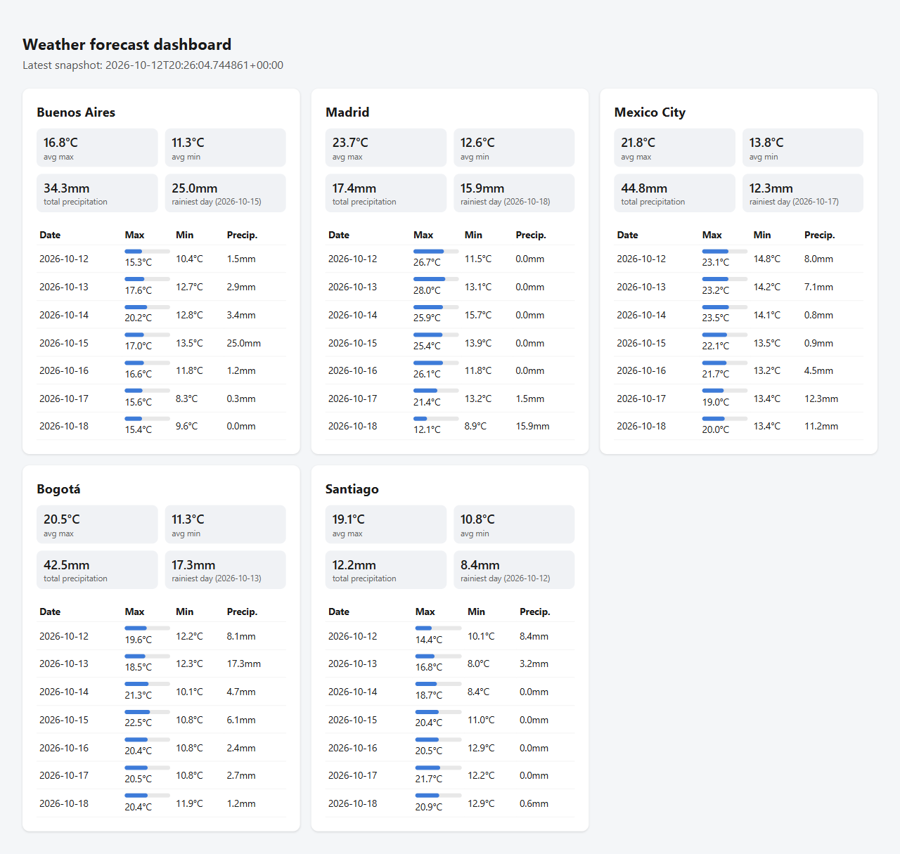

# ⛅ Weather REST API to JSON Dashboard

**A small ETL pipeline: weather API → clean history → KPI dashboard.**

A Python script that fetches the 7-day forecast for five cities from the [Open-Meteo](https://open-meteo.com/) API, adds it to a growing history in JSON and CSV, and builds a static HTML dashboard with KPIs per city.

## 📸 Dashboard



## ✨ Features

- **Extract:** 7-day forecast (max/min temperature, precipitation, weather code) for Buenos Aires, Madrid, Mexico City, Bogotá and Santiago.
- **Transform:** turns the API's column-based JSON into one clean record per city and day; missing values are kept as `null`.
- **Load:** every run is added to the history instead of overwriting it, so you can see how the forecast for the same day changes over time.
- **Outputs:** `weather_history.json`, `weather_history.csv` (ready for Excel or pandas) and `dashboard.html`.
- **Dashboard:** KPI cards per city (average max/min temperature, total precipitation, rainiest day) and a 7-day table. Opens with a double-click, no server needed, and works on mobile.
- **Tested:** pytest suite, run automatically by GitHub Actions on every push.

## 🛠️ Tech stack

- Python
- REST APIs · JSON · CSV
- ETL pipeline
- HTML/CSS dashboard
- pytest · GitHub Actions (CI)

## ⚡ Run locally

Requirements: [uv](https://docs.astral.sh/uv/) (installs Python and all dependencies).

```bash
uv sync
uv run python -m weather_rest_api_to_json_dashboard
```

Each run prints a 7-day summary per city and writes the three output files to the current folder.

## 📄 Output format

One record per city and day:

```json
{
  "fetched_at": "2026-09-07T13:23:17+00:00",
  "city": "Madrid",
  "date": "2026-09-07",
  "temp_max": 36.4,
  "temp_min": 20.9,
  "precipitation": 0.0,
  "weathercode": 3
}
```

Temperatures in °C, precipitation in mm. `weathercode` follows the [WMO weather codes](https://open-meteo.com/en/docs#weather_variable_documentation).

## 📁 Project structure

- `src/weather_rest_api_to_json_dashboard/__init__.py` — fetch from the API, build records, save JSON/CSV
- `src/weather_rest_api_to_json_dashboard/dashboard.py` — builds the HTML dashboard
- `tests/` — pytest suite
- `.github/workflows/` — CI: ruff + pytest
